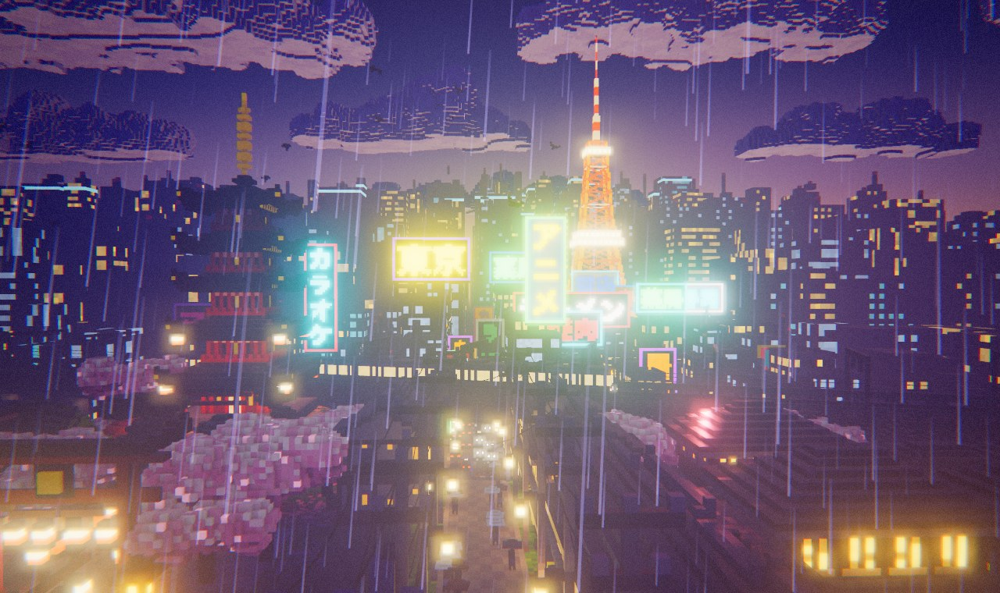
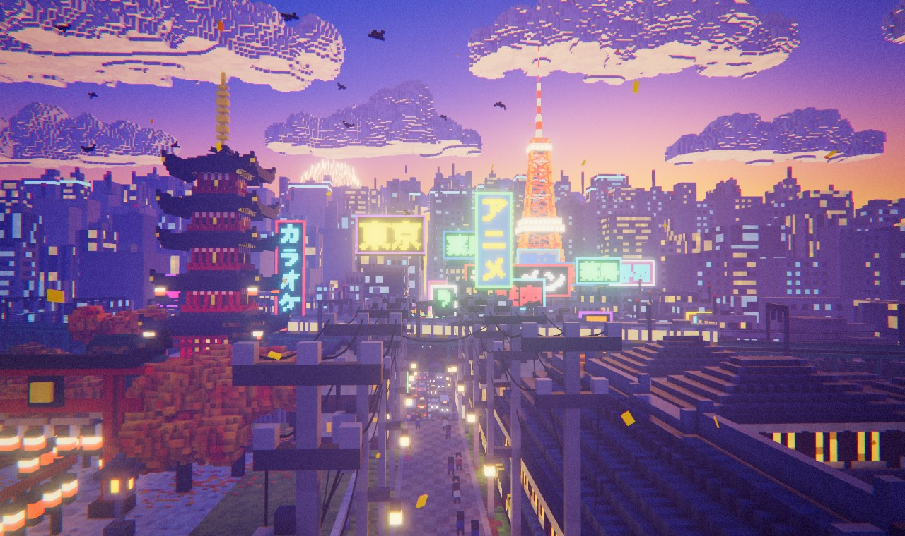
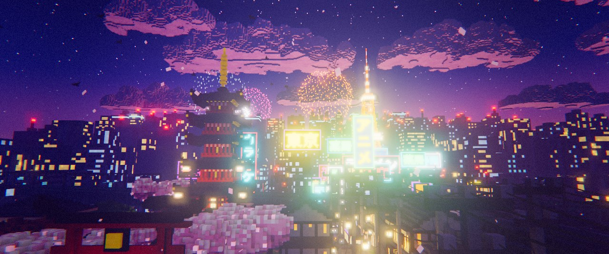
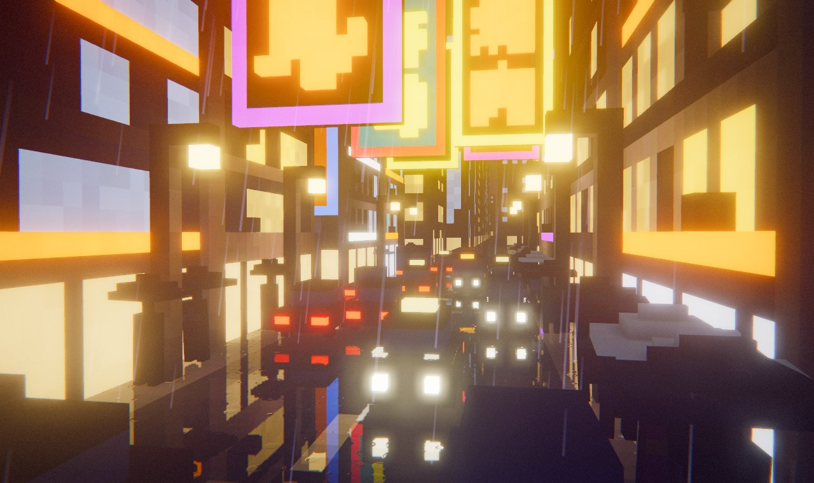
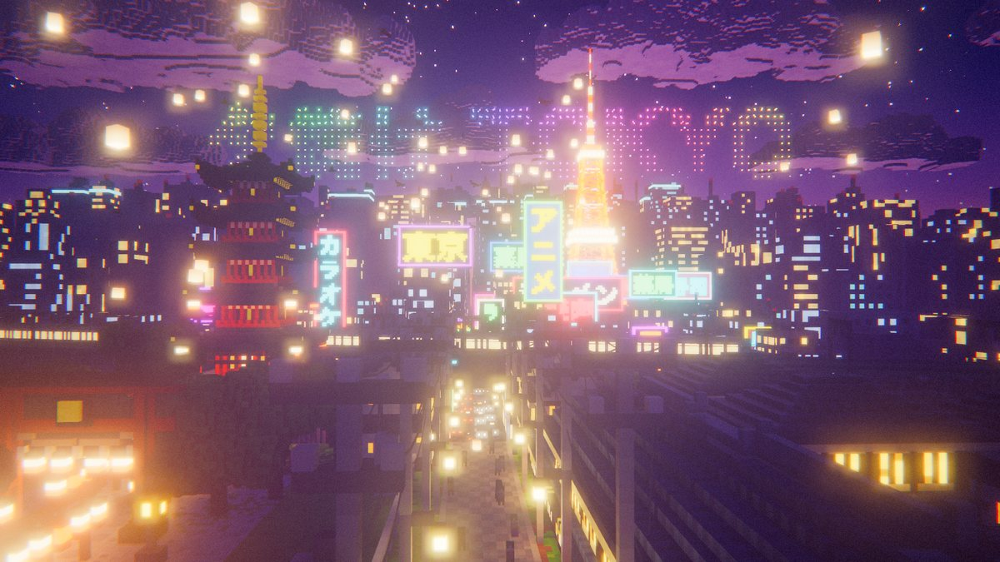
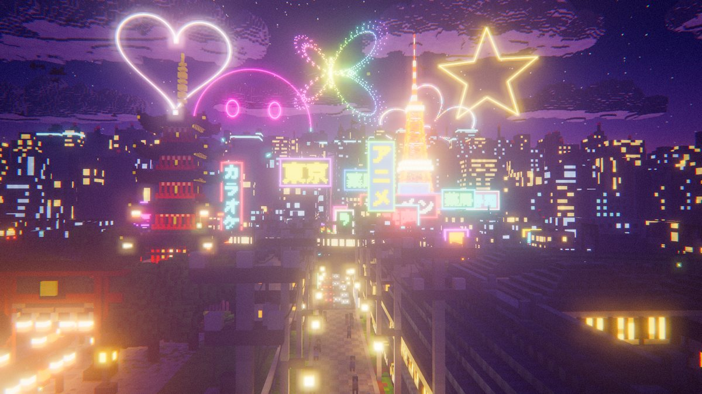
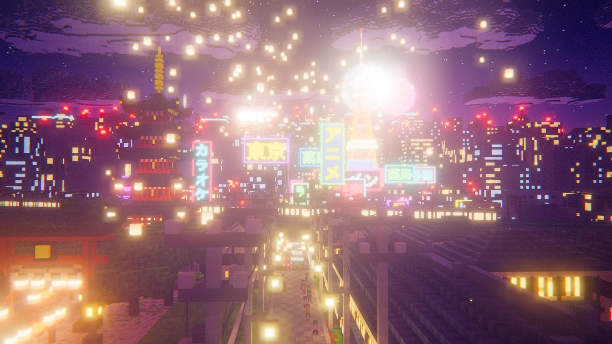
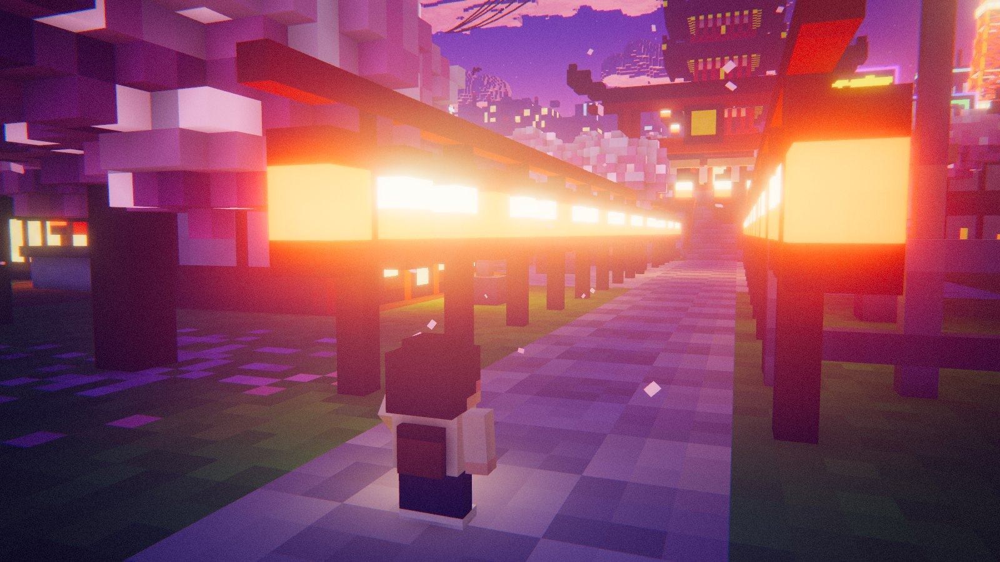

# Afterglow — Voxel Tokyo at dusk

An interactive voxel diorama based on *Tokyo Sunset: Pagoda and Neon Skyline*. It includes a five-storey pagoda on a stone-walled hill, a torii and lantern approach, sakura, a downhill old town, an elevated railway with moving trains, a neon district, and a glowing Tokyo Tower against a violet sunset.

Everything is generated procedurally in the browser in a few seconds. There are no model files and no build step.

| Rain at blue hour | Autumn | 花火 · fireworks | Neon in the rain |
| --- | --- | --- | --- |
|  |  |  |  |

| 空文字 · write in the sky | Shaped shells | 祭 · Matsuri night |
| --- | --- | --- |
|  |  |  |



## Run

```bash
cd web
python3 -m http.server 5180
```

Then open <http://localhost:5180>. Any static file server works.

URL options: `?view=hero|shrine|pagoda|street|neon|rail|tower|aerial`, `?t=0..1` (time of day), `?cine` (start the film), `?noui`,
`?season=spring|summer|autumn|winter`, `?weather=clear|rain|snow`, `?style=ink`, `?hanabi=1`, `?life=0`,
`?sign=TEXT&signc=pink|cyan|yellow|purple|green|orange|red|white&signs=panel`, `?cam=x,y,z,tx,ty,tz`,
`?sky=MESSAGE&skyp=rainbow|gold|sakura|neon|confetti` (fireworks that spell it), `?lanterns=1`, `?matsuri`, `?walk=x,y,z,yaw` (start on foot there).
The link button builds these for you.

## Controls

| Input | Action |
| --- | --- |
| Drag / right-drag / scroll | orbit / pan / zoom |
| Double-click | focus the orbit on that spot |
| W A S D, Q E (Shift = fast) | fly |
| 1–8 | viewpoints |
| V | 歩 walk mode: explore the streets as a little voxel person |
| W A S D / Shift / Space (walking) | walk / run / jump; drag to look around, ← → to turn the camera |
| E (walking) | the thing to do here: pray at the shrine and draw a fortune, strike the temple bell, buy a drink, let a lantern go |
| C | cinematic mode (Space pause, ← → shots, Esc exit) |
| T | cycle time of day |
| M | music: 夕焼けラジオ · Afterglow FM (volume in the now-playing pill) |
| N | city sound (環境音) on/off, independent of the music |
| Z / X | cycle season (春 夏 秋 冬) / weather (晴 雨 雪) |
| B · I · L · K | fireworks (花火) · ink outlines (墨) · street life (人) · sky lanterns (灯) |
| Y · G | write a message in the sky (空文字) · grand finale (スターマイン) |
| Click the sky | launch a shell there (while the fireworks are on) |
| R | record a clip (Shift+R or Shift-click: record the whole film) |
| P | screenshot (Shift+P: 4K postcard) · F fullscreen · H hide UI · \` stats |
| Drop an audio file | the city plays and pulses to your own track |

## How it works

- **`src/voxel.js`**: a sparse chunked voxel store with 64³ chunks and a mesher. The mesher culls hidden faces, bakes per-vertex ambient occlusion with anisotropy-correct quad splits, and bakes point-light spill from lanterns, lamps and signs into a vertex attribute. Vertex data is packed into 16 bytes per vertex. Emissive voxels are tagged with a group, so neon flicker, the tower lights, window lights and aviation blinkers can animate without remeshing.
- **`src/sky.js`**: the analytic sunset sky. The same function drives the sky dome, the aerial-perspective fog, and the cloud tint, so distant blocks melt into the sky. It has four time-of-day keyframes: Golden hour, Sunset (the painting), Blue hour, and Night.
- **Worlds at several scales**: the old town, district and tower use 1-unit voxels. The skyline uses 3-unit voxels out to about 800 m and 6-unit voxels to the horizon. Clouds use 9-unit voxels.
- **`src/build/*`**: the procedural builders for terrain, pagoda, shrine, machiya houses, trees, neon district, skyline, Tokyo Tower, railway, train, props and clouds. Neon signs are rasterised from real Japanese text.
- **`src/fx.js`**: GPU-animated sakura petals, plus the post stack: MSAA HDR, bloom, an optional tilt-shift "diorama" pass, colour grade (vignette, chromatic fringe, grain), and ACES output.
- **`src/atmos.js`**: seasons and weather, all done with uniforms so nothing is re-meshed. Each palette entry has a season class (sakura, leaves, grass or maple) packed into the high bits of its group byte. The shader re-tints those classes while keeping their baked AO.
  - Summer: green canopies, fireflies and fireworks.
  - Autumn: momiji and falling leaves.
  - Winter: snow-laden branches and blocky snow on every upward face.
  - Rain: the sky and fog go overcast and streaks fall around the camera. Streets turn wet with puddles and raindrop ripples, and a planar reflection mirrors the neon and headlights in the asphalt.
- **`src/hanabi.js`**: GPU fireworks (peony, willow, ring, chrysanthemum, palm, strobe). Each burst briefly lights the city, and its boom arrives late, delayed by distance.
  - Colour modes: solid, rainbow, split, confetti and gradient shells.
  - Shaped shells (heart, star, smile, sakura, butterfly) open on a plane that faces you.
  - 空文字 sky-writing: a shell bursts as a sphere, then its sparks rearrange into your text (Latin or Japanese), hang there, and drip away. Long messages go up one shell at a time.
  - The 祭 Matsuri button sets a summer festival night: fireworks, lanterns, music and a grand finale.
- **`src/walker.js`** and **`src/walkmode.js`**: 散歩, walk mode. The walker is built from the same voxels as the city, so it gets the same light, wet streets and snow on its head.
  - It dresses for the season: a jacket and sakura hairpin in spring, a yukata with a fan in the obi in summer, a scarf in autumn, a beanie and mittens in winter. It opens a clear umbrella in the rain and carries a paper lantern after dark; the lantern lights the street through a single shader uniform rather than a real light.
  - Physics runs against the voxel world and the railway viaduct, stepping up kerbs and stairs. A jump clears a 2-voxel wall, and jumping at a ledge climbs onto it. Footsteps change with the surface and the weather (stone, gravel, grass, wood, puddles, snow).
  - The follow camera never sits inside a building, a tree or the viaduct (voxel meshes have no inner faces, so it would see straight through them). When the view behind the walker is blocked it swings round or rises over its head.
  - Cars stop and queue for you in the road, and honk if you stay. People wait for you to pass.
  - Nine places to find, with a title card for each and a minimap. On touch screens there is a joystick and buttons.
- **`src/lanterns.js`**: sky lanterns that lift off from the old street, the shrine and the district, then drift out over the skyline on the evening air. They are instanced and reflect in wet streets.
- **`src/soundscape.js`**: 環境音, the city's own sound, on a channel separate from the music. It starts on your first click or key press; N mutes it, and the setting is remembered. Every layer is synthesized and follows where the camera is:
  - a traffic hum that grows in the district and fades as you climb
  - crowd murmur on the streets, thinned by rain and snow
  - cicada showers and minmin-zemi on summer days; higurashi at summer dusk
  - bell crickets and field crickets on summer and autumn nights
  - crows at golden hour, and the temple bell at night (louder near the pagoda)
  - the town's evening chime when dusk arrives
  - wind that strengthens with altitude and in winter
- **`src/life.js`**: instanced voxel traffic driving on the left, pedestrians who open umbrellas when it rains, and crows circling the pagoda.
- **`src/sign.js`**: lets you hang your own neon or lightbox sign on the railway bridge.
- **Ink style**: a post pass that draws anime-style outlines from depth silhouettes and creases, with soft cel banding.
- **Eye adaptation**: exposure and bloom ease down when you walk among the signs at night, and at street level after dark, where a lantern a metre away would otherwise flood the frame.
- **Wet streets** reflect the city through a planar mirror placed at the street level under the camera: the old town's plateau or the low district.
- **`src/cinematic.js`**: a nine-shot director with eased camera paths, dip-to-black cuts, a 2.39:1 letterbox, and captions. The fireworks shot is included only while fireworks are on.
  - With music playing, cuts are stretched to land on bar lines and the lens pulses with the kick drum.
- **`src/audio.js`**: *Afterglow FM*, a generative lo-fi / city-pop soundtrack composed live in WebAudio with no audio files. It combines an FM electric piano with tape wow, a Karplus-Strong koto playing a pentatonic melody (with occasional *oshide* pitch bends), a sine bass, saw pads, swung synthesized drums with side-chain pumping, vinyl crackle, wind, and fūrin chimes.
  - It is arranged in sections: intro → groove → melody → busier groove → breakdown.
  - Each time of day has its own mood, which takes over at the next bar line: Golden hour 84 BPM, Sunset 78, Blue hour 72, Night 66 (half-time).
  - Neon signs pulse with the kick drum, cinematic cuts trigger bell accents, entering cinematic mode starts the music, and passing trains rumble and clack, panned to their position on screen.
  - Weather has its own sound: rain hiss, drips and the odd roll of thunder; snow muffles the mix. These, the trains and the fireworks belong to the city channel, so they keep playing with the music off.
  - If you drop in your own track, an onset detector drives the neon instead.
  - Recording captures the canvas together with the soundtrack.

Rendering adapts its pixel ratio to keep the frame rate up.
